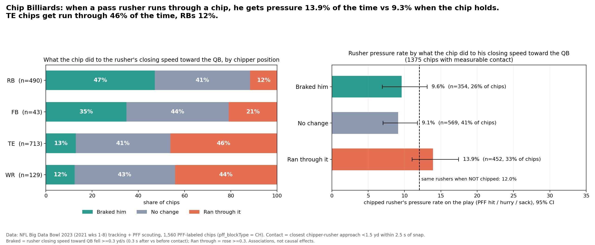

# Chip Billiards: does a TE/RB chip actually brake the pass rusher?

**What we built and what it shows:** Chip Billiards treats each of the 1,560 PFF-labeled chip blocks by a TE, RB, FB or WR (2021 weeks 1–8) as a collision. It compares the chipped rusher's closing speed toward the QB in the 0.3 s before and after contact. When the rusher **runs through the chip** (speeds up toward the QB after contact, 33% of chips), he records a pressure on **13.9%** of plays, vs **9.3%** when the chip holds (braked or no change; p ≈ 0.01). **TE chips get run through 46% of the time, RB chips only 12%** (RBs brake the rusher on 47% of their chips), and a per-player report card shows which chippers actually slow rushers down. An offensive coordinator or TE/RB coach would use this to decide who chips which edge rusher. A scout would use it to grade chippers on effect rather than volume. **Limitations:** these are associations, not causal effects, since chips aren't randomly assigned. Contact is estimated from tracking distance (closest approach under 1.5 yd within 2.5 s). PFF pressure credits are per play, not timestamped. RB chips happen later and closer to the QB (median 1.8 s vs 1.2 s for TEs), so part of their "braking" may be the rusher's natural deceleration.



## Run
```bash
pip install -r requirements.txt
python get_data.py        # downloads the event data (~880 MB) into ./data
python chip_billiards.py  # ~2 min first run; writes everything to ./outputs
```

## Method (per chip)
1. `pffScoutingData`: `pff_blockType == "CH"` by a TE/RB/FB/WR. The chipped rusher is `pff_nflIdBlockedPlayer` and the QB is `pff_role == "Pass"`.
2. Tracking is normalized so the offense always moves right. Contact is the closest chipper–rusher approach after the snap: it must be under 1.5 yd, within 2.5 s, and a true minimum.
3. Rusher velocity is measured 0.3 s before and 0.3 s after contact (rusher speed must be > 1.5 yd/s). Δclose is the change in his velocity component toward the QB.
   - **Braked him:** Δclose ≤ −0.3 yd/s
   - **Ran through it:** Δclose ≥ +0.3 yd/s
   - **No change:** everything in between
4. The outcome is whether that rusher got a PFF hit, hurry or sack on the play. Baseline: the same rushers have a 12.0% pressure rate when not chipped.

## Outputs
- `outputs/chip_billiards_hero.png`: main figure
- `outputs/chipper_leaderboard.png` / `.csv`: report card for players with ≥ 12 measurable chips
- `outputs/shot_chart.png`: rusher velocity after contact, in the rusher's frame of reference
- `outputs/validation_examples.png`: example plays with the detected contact frame marked, used to spot-check the method
- `outputs/chips.csv`: one row per chip with all features
- `outputs/summary.txt`: key numbers
